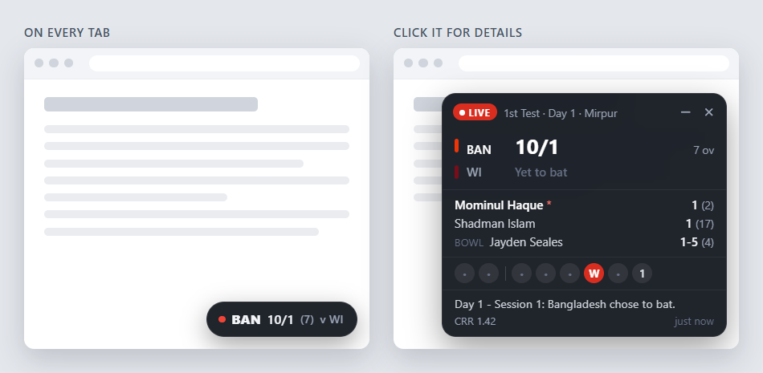

# Floating Cricket Score

A small live cricket score that floats on every tab in Brave, Chrome or Edge, like the score bubble on your phone.
You don't have to keep switching to the scorecard tab to see what's happening. Scores come from ESPNcricinfo.



## What it does

- Shows a one-line score (`● BAN 56/1 (18.2) v WI`) on every tab. Click it for the batters, bowler, recent balls and run rate.
- Drag it anywhere. It stays in that spot on every tab.
- Flashes on wickets, fours and sixes.
- Starts on the biggest live international match. Pick another from the live list, or paste any Cricinfo match link.
- Puts the score on the toolbar icon too. **Alt+Shift+C** shows or hides it.

## Install

1. Download **floating-cricket-score.zip** from the [latest release](https://github.com/Aranya016/floating-cricket-score/releases/latest) and unzip it.
2. Open `brave://extensions` (Chrome: `chrome://extensions`, Edge: `edge://extensions`).
3. Turn on **Developer mode** (top-right).
4. Click **Load unpacked** and choose the unzipped `cricket-float` folder, the one with `manifest.json` in it.
5. Pin the red ball icon from the puzzle-piece menu.

Keep that folder where it is, because the browser runs the extension from it.
To update, replace the folder's contents with a newer release and press ↻ on the extension in the extensions page.

## Privacy

No account, no tracking, nothing collected or sent anywhere. The extension only contacts cricinfo.com, to load the match you follow.
Your settings stay in your browser. It asks to run on all websites only so it can draw the score on them.

## Good to know

- It reads the match's public Cricinfo page every 20 seconds (you can change this), which can be about a minute behind the live ball-by-ball feed.
  If the match is also open in a Cricinfo tab, it picks up that tab's live score within seconds.
- Browsers don't let extensions draw on their own pages (new tab, settings, the extension store), so the score isn't shown there.
- If Cricinfo changes how its pages are built, the extension may stop working until it's updated. Please open an issue if that happens.

## Development

No build step or dependencies; you only need [Node.js](https://nodejs.org) for the tests.

```bash
node dev/test.js
```

`node dev/serve.js` serves previews with a fake `chrome` API at `http://127.0.0.1:8766/dev/page.html` (the score on a page) and `/dev/gallery.html` (every state).
`node dev/make-icons.js` redraws the icons.

The extension lives in `cricket-float/`:

- `background.js`: fetches the match, decides when to refresh, toolbar badge, wicket/boundary alerts
- `parser.js`: turns Cricinfo's page data into a small score object
- `widget.js`: how the score looks (shared by the pages and the toolbar menu)
- `content.js`: puts the score on each page; dragging, expanding, hiding
- `popup.*`: the toolbar menu

## Disclaimer

This is an independent, non-commercial project. It isn't affiliated with or endorsed by ESPN or ESPNcricinfo.
Match data belongs to its owners.

## License

[MIT](LICENSE)
